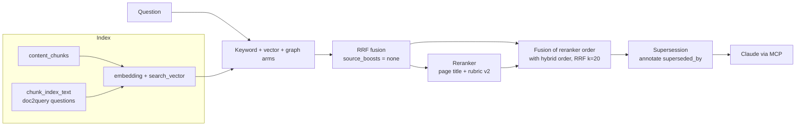
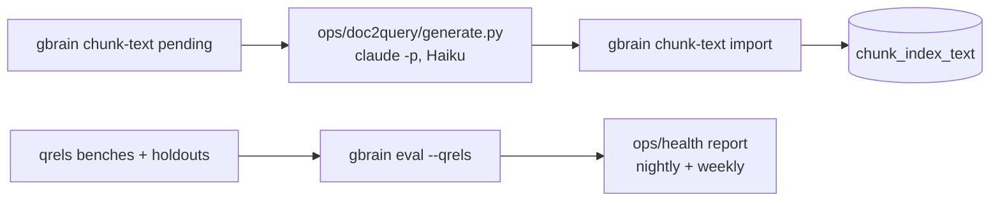

# augmented-rag: measured retrieval for gbrain

[](https://github.com/gabrielkpo/augmented-rag/actions/workflows/ci.yml)
[](https://github.com/gabrielkpo/augmented-rag/actions/workflows/codeql.yml)
[](LICENSE)

**This repository is a fork of [gbrain](https://github.com/garrytan/gbrain), created by Garry Tan.** gbrain itself (the engines, hybrid search, MCP server, schema packs, skills and nearly all of the code here) is his work and that of its contributors. This fork adds a measurement study of gbrain's retrieval on a real 1,200-page knowledge base, and a few opt-in patches that the study justified: reranker fusion, doc2query and page supersession.

> **Status:** first research round complete (21 to 23 October 2026); the patches run daily on one brain. They are not merged upstream and will move with upstream releases. The method and every number are in [docs/fork/research/](docs/fork/research/README.md).

## Why

gbrain's defaults are tuned on its author's brain and on public benchmarks. On a different corpus (chat threads, meeting notes, project pages, mostly in French), the right page was in the top 5 for only 68% of real questions. The fork measures before it changes anything, under one rule: **gbrain indexes, Claude reasons** (gbrain calls no chat model; anything that writes or judges goes through Claude, outside gbrain).

## What is upstream, what is ours

| Upstream gbrain (Garry Tan and contributors) | This fork |
|---|---|
| The whole system: PGLite and Postgres engines, hybrid search (keywords, vectors, graph), reranker providers, MCP server, CLI, sync, skills | Question benches with holdouts, and the scripts to run them (`ops/eval/`) |
| The `gbrain eval --qrels` harness the benches run on | A diagnosis of where retrieval failed on this corpus |
| | Patches, each opt-in and off by default: reranker fusion, page title and rubric for the reranker, doc2query storage (`chunk_index_text`), supersession, one `eval --expand` fix |
| | A written record of what was tried and dropped, with numbers |

The full list of fork commits is in appendix B of the [write-up](docs/fork/research/gbrain-2.0-paper.md).

## Method

Each idea is a hypothesis to test, not a feature to add:

1. **Benches first.** Question sets in gbrain's native qrels format: a tuning bench (107 questions, half of them real queries from agent sessions), holdout A (41) to validate a choice, holdout B (41) opened once at the end. No question is shared between them.
2. **One change at a time**, measured with Recall@5, MRR and nDCG@5 against the previous configuration.
3. **Isolated labs.** Index changes run on fresh lab brains built from a snapshot, never on the live brain.
4. **Paired bootstrap confidence intervals** for every comparison; a gain inside the noise counts as no gain.
5. **End-to-end check.** A multi-step bench where Claude answers with read-only gbrain tools and a second model judges the answers against verified references.
6. **Negative results are kept** and documented as carefully as the changes that shipped.

## Research axes

The work is organised in six axes. In each one, several published methods are compared with each other and with what gbrain does today, on the same benches, with a protocol written before measuring.

| Axis | Question | Compared so far | Next candidates |
|---|---|---|---|
| **Temporality and truth** | What is true now, when pages from different periods disagree? | Page-level supersession: detection works (8 reliable pairs out of 799), annotate shipped, demotion neutral to harmful | Filling dated facts; bitemporal graph (Zep / Graphiti) |
| **Indexing** | In what form should a chunk be indexed so a question finds it? | doc2query **shipped** (+0.20 MRR on the target); per-chunk context (Anthropic) dropped; rewritten titles, French full text | Learned sparse retrieval (SPLADE) |
| **Chunking** | Which unit to index, which unit to return? | — | `return_unit` (search small, return big); atomic propositions; late chunking |
| **Routing** | Should every question be handled the same way? | Thematic router (GraphRAG / RAPTOR style) dropped; strategy routing (Adaptive-RAG) no headroom | Relational planner measured in isolation |
| **Ranking** | How to order candidates, how many times to search? | Reranker fused with the hybrid order **shipped**; query expansion, autocut, iterative search dropped | Voyage reranker against the current one; usage feedback |
| **Session context** | What should the agent know before it searches? | — | On-demand project dossier with prompt caching; overnight preparation |

Each axis, its methods, their sources and the protocols are detailed in §5 of the [write-up](docs/fork/research/gbrain-2.0-paper.md).

## How it works



Generation and judging run outside gbrain:



**Choices and their trade-offs**

- **Fuse the reranker with the hybrid order rather than replace it.** Each missed 7 different questions; RRF keeps both. Cost: one more ranking step.
- **doc2query in its own table (`chunk_index_text`) rather than in the page body.** Pages stay untouched and the feature is byte-identical when off. Cost: a schema migration (v265) to carry across upstream upgrades.
- **Report stale pages rather than demote them.** A superseded page stays the right answer about its own history. Cost: the agent must read the annotation.

## Example

A doc2query line handed to `gbrain chunk-text import` (synthetic):

```json
{"slug": "projects/atlas", "chunk_hash": "<sha256 of the chunk>", "questions": ["Which provider hosts Atlas?", "When did Atlas move to the new provider?"], "model": "claude-haiku-5-5", "prompt_version": "3-questions"}
```

With `search.chunk_index_text = d2q`, the chunk's embedding text becomes:

```text
<context>Atlas — billing migration project
Which provider hosts Atlas?
When did Atlas move to the new provider?
</context>
<the original chunk text, unchanged>
```

## Results

One knowledge base of about 1,160 pages and 3,780 chunks (chat threads, meeting notes, project, process and person pages), mostly in French. Recall@5 / MRR / nDCG@5 with `gbrain eval --qrels`.

| Bench | Upstream defaults | This fork |
|---|---|---|
| v2, 107 questions (tuning) | 0.68 / 0.60 / 0.58 | **0.92 / 0.86 / 0.85** |
| Holdout A, 41 questions | 0.85 / 0.76 / 0.75 (reranker alone) | **0.91 / 0.84 / 0.83** |
| Holdout B, 41 questions, opened once | — | **0.92 / 0.89 / 0.88** |
| Answer in a middle chunk of a long page, 40 questions | 0.57 / 0.51 / 0.53 | **0.78 / 0.70 / 0.72** (doc2query) |

Details, confidence intervals and the end-to-end agentic bench: [research summary](docs/fork/research/README.md), [full write-up](docs/fork/research/gbrain-2.0-paper.md).

## Run it

Prerequisites: [Bun](https://bun.sh) ≥ 1.4, Postgres with pgvector (or the embedded PGLite engine), an embeddings key, and a reranker key for the fusion step.

```bash
git clone https://github.com/gabrielkpo/augmented-rag.git && cd augmented-rag
bun install && bun link                       # installs the gbrain CLI from this fork
gbrain init                                   # creates the brain (see docs/INSTALL.md)
gbrain config set search.source_boosts none   # the largest single gain
gbrain config set search.chunk_index_text d2q # doc2query, after generating questions
```

Then `GBRAIN_RERANK_FUSION=rrf`, `GBRAIN_RERANK_RUBRIC=v2` and `GBRAIN_SUPERSEDE=annotate` in the environment; full configuration in appendix A of the write-up.

## Project structure

| Path | Content |
|---|---|
| `src/core/search/` | Hybrid search, reranker fusion (`rerank.ts`), supersession (`hybrid/supersession.ts`) |
| `src/core/chunk-index-text*.ts`, `src/commands/chunk-text.ts` | doc2query storage, refresh and CLI |
| `ops/doc2query/` | Question generation through `claude -p` and import |
| `ops/eval/` | Bench runner, agentic bench and judge, chunk, truth and router labs |
| `ops/health/`, `ops/freshness/`, `ops/hygiene/` | Health report, freshness indicator, nightly hygiene |
| `ops/fork-sync/` | Guard and script that keep this public fork apart from the private overlay |
| `docs/fork/` | Research write-up and fork workflow |

Everything else is upstream gbrain, documented in `docs/` and [upstream's README](https://github.com/garrytan/gbrain#readme).

## Data and privacy

Question sets (`qrels*.json`), results, generated questions and page content are never in this repository: they stay in a private overlay ([fork workflow](docs/fork/WORKFLOW.md)), and `ops/fork-sync/guard-pre-push.sh` refuses to push them here. On each search, the question goes to the embeddings provider, and the question plus about 25 candidate passages go to the reranker provider.

## Limitations and next

- One corpus: conclusions hold for chat-heavy, mostly French content of about 1,200 pages.
- Bench "real queries" are those Claude sent during sessions.
- Labels miss some relevant pages; the agentic judge (Claude Haiku) varies by about ±0.15 between identical runs.
- The reranker can move a page by one place between calls.
- Local patches must be carried at each upstream upgrade until they are merged upstream.
- Next: the open candidates of each axis above.

## Development

```bash
bun install
pre-commit install                 # gitleaks, ruff on ops/
bun run typecheck
bun test --timeout=60000 test/chunk-index-text.test.ts
```

Every change is a pull request with a Conventional Commits title, a security review and a code review, squash-merged once `test`, `gitleaks` and `semantic-title` are green. Upstream sync and the private overlay: [docs/fork/WORKFLOW.md](docs/fork/WORKFLOW.md).

## License and credits

MIT, see [LICENSE](LICENSE), which keeps Garry Tan's copyright. gbrain is Garry Tan's project: thanks to him and to gbrain's contributors for building and openly publishing the system this study stands on. This fork only adds the measurement work and the patches listed above; findings that would help upstream are meant to be offered back to it.
