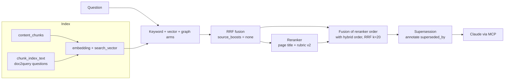
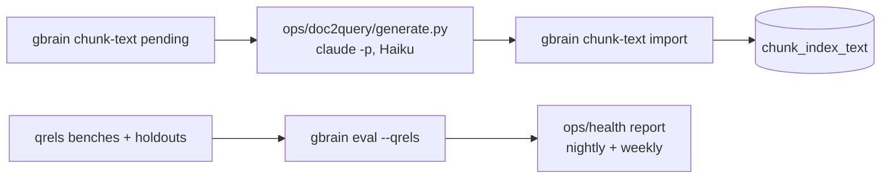

# augmented-rag: measured retrieval for gbrain

[](https://github.com/gabrielkpo/gbrain/actions/workflows/ci.yml)
[](https://github.com/gabrielkpo/gbrain/actions/workflows/codeql.yml)
[](LICENSE)

A research fork of [gbrain by Garry Tan](https://github.com/garrytan/gbrain). It measures gbrain's retrieval on a real 1,200-page knowledge base and keeps only the changes that a question bench and a holdout prove useful: reranker fusion, doc2query and page supersession, all opt-in.

> **Status:** research complete for the first round (October 2026), changes running daily on one brain. They are local patches, not merged upstream, so expect them to move with upstream releases. The method and every number are in [docs/fork/research/](docs/fork/research/README.md).

## Why

gbrain gives an agent a memory it controls: Markdown pages, Postgres with pgvector, hybrid search, an MCP server. Its defaults are tuned on the author's own brain and on public benchmarks. On a different corpus (mostly chat threads, meeting notes and project pages, mostly in French) the right page was in the top 5 for only 68% of real questions. Adding features would not tell which part was failing. This fork builds question benches first, then changes one thing at a time and keeps it only if the numbers move on data it was not tuned on.

One rule shapes every change: **gbrain indexes, Claude reasons**. gbrain calls no chat model; anything that writes or judges goes through Claude, outside gbrain.

## How it works



Generation and judging run outside gbrain:



**Choices and their trade-offs**

- **Fuse the reranker with the hybrid order rather than replace it.** The reranker and hybrid search each missed 7 different questions; RRF keeps both signals. Cost: one more ranking step, no extra call.
- **doc2query in its own table (`chunk_index_text`) rather than in the page body.** Pages stay untouched and the feature is byte-identical when off. Cost: a schema migration (v265) to carry across upstream upgrades.
- **Report stale pages rather than demote them.** A superseded page is still the right answer for questions about its history; demoting it hurt those questions. Cost: the agent has to read the annotation.
- **Turn slug-prefix boosts off rather than retune them.** The ×1.5 boost on `originals/` was set for another brain and crowded out factual pages here.

## Example

A doc2query line handed to `gbrain chunk-text import` (synthetic):

```json
{"slug": "projects/atlas", "chunk_hash": "<sha256 of the chunk>", "questions": ["Which provider hosts Atlas?", "When did Atlas move to the new provider?"], "model": "claude-haiku-5-5", "prompt_version": "3-questions"}
```

With `search.chunk_index_text = d2q`, the chunk's embedding text becomes:

```text
<context>Atlas — billing migration project
Which provider hosts Atlas?
When did Atlas move to the new provider?
</context>
<the original chunk text, unchanged>
```

## Results

Measured on one knowledge base of about 1,160 pages and 3,780 chunks (chat threads, meeting notes, project, process and person pages), mostly in French. Tuned on bench v2, validated on holdout A, holdout B opened once; no question is shared. Recall@5 / MRR / nDCG@5 with `gbrain eval --qrels`.

| Bench | Upstream defaults | This fork |
|---|---|---|
| v2, 107 questions (tuning) | 0.68 / 0.60 / 0.58 | **0.92 / 0.86 / 0.85** |
| Holdout A, 41 questions | 0.85 / 0.76 / 0.75 (reranker alone) | **0.91 / 0.84 / 0.83** |
| Holdout B, 41 questions, opened once | — | **0.92 / 0.89 / 0.88** |
| Answer in a middle chunk of a long page, 40 questions | 0.57 / 0.51 / 0.53 | **0.78 / 0.70 / 0.72** (doc2query) |

Measured and dropped: query expansion (no gain, +5 s per search), per-chunk context (+0.02 MRR, within noise), autocut (no effect), demoting superseded pages (neutral to harmful), a thematic router (intervals include 0), iterative-search instructions and strategy routing (no headroom). Details, confidence intervals and the end-to-end agentic bench: [research summary](docs/fork/research/README.md), [full write-up](docs/fork/research/gbrain-2.0-paper.md).

## Run it

Prerequisites: [Bun](https://bun.sh) ≥ 1.4, Postgres with pgvector (or the embedded PGLite engine), an embeddings key, and a reranker key for the fusion step.

```bash
git clone https://github.com/gabrielkpo/gbrain.git && cd gbrain
bun install && bun link                       # installs the gbrain CLI from this fork
gbrain init                                   # creates the brain (see docs/INSTALL.md)
gbrain config set search.source_boosts none   # the largest single gain
gbrain config set search.chunk_index_text d2q # doc2query, after generating questions
```

Reranker fusion and the rubric are environment settings: `GBRAIN_RERANK_FUSION=rrf`, `GBRAIN_RERANK_RUBRIC=v2`, and `GBRAIN_SUPERSEDE=annotate` for supersession. The full live configuration is in appendix A of the write-up.

## Project structure

| Path | Content |
|---|---|
| `src/core/search/` | Hybrid search, reranker fusion (`rerank.ts`), supersession (`hybrid/supersession.ts`) |
| `src/core/chunk-index-text*.ts`, `src/commands/chunk-text.ts` | doc2query storage, refresh and CLI |
| `ops/doc2query/` | Question generation through `claude -p` and import |
| `ops/eval/` | Bench runner, agentic bench and judge, chunk, truth and router labs |
| `ops/health/`, `ops/freshness/`, `ops/hygiene/` | Health report, freshness indicator, nightly hygiene |
| `ops/fork-sync/` | Guard and script that keep this public fork apart from the private overlay |
| `docs/fork/` | Research write-up and fork workflow |

Everything else is upstream gbrain; its documentation lives in `docs/` and in [upstream's README](https://github.com/garrytan/gbrain#readme).

## Data and privacy

The benches reference pages of a private brain, so the question sets (`qrels*.json`), results, generated questions and page content are never in this repository. They live in a private overlay that shares this history ([fork workflow](docs/fork/WORKFLOW.md)); `ops/fork-sync/guard-pre-push.sh` refuses to push private paths here. On each search, the question goes to the embeddings provider and the question plus about 25 candidate passages go to the reranker provider.

## Limitations and next

- One corpus: conclusions hold for chat-heavy, mostly French content of about 1,200 pages.
- Bench "real queries" are those Claude sent during sessions, often keyword bags.
- Labels miss some relevant pages; the agentic judge (Claude Haiku) varies by about ±0.15 between identical runs.
- The reranker can move a page by one place between calls.
- Local patches must be carried at each upstream upgrade until they are merged upstream.
- Next: compare a Voyage reranker against the current one, test `return_unit`, and measure a cached project dossier for long sessions.

## Development

```bash
bun install
pre-commit install                 # gitleaks, ruff on ops/
bun run typecheck
bun test --timeout=60000 test/chunk-index-text.test.ts
```

Every change goes through a pull request with a Conventional Commits title, a security review and a code review, and is squash-merged once CI is green (`test`, `gitleaks`, `semantic-title`). Upstream's own workflows need its runners and are disabled here. Pulling upstream changes and the private overlay are described in [docs/fork/WORKFLOW.md](docs/fork/WORKFLOW.md).

## License and credits

MIT, see [LICENSE](LICENSE). gbrain is Garry Tan's project and the large majority of this code is his and its contributors'; this fork adds the measurement work and the patches listed in appendix B of the write-up.
