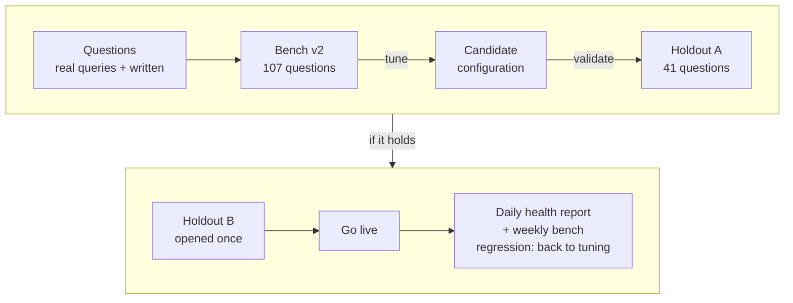
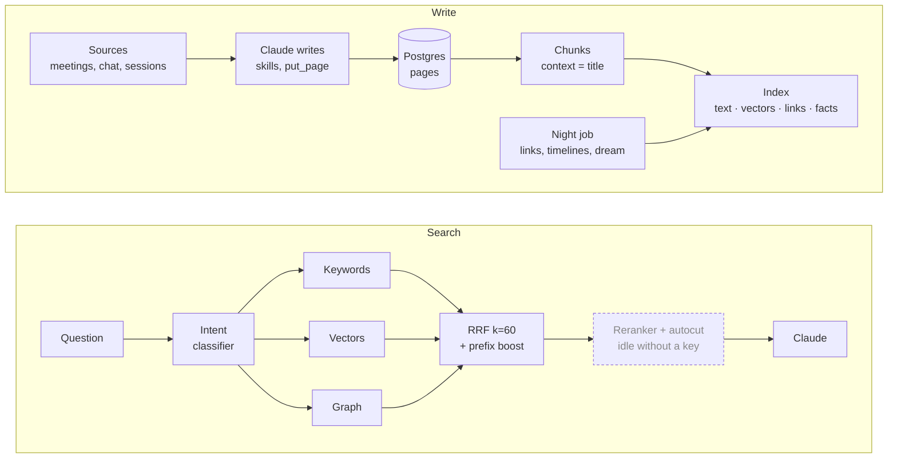
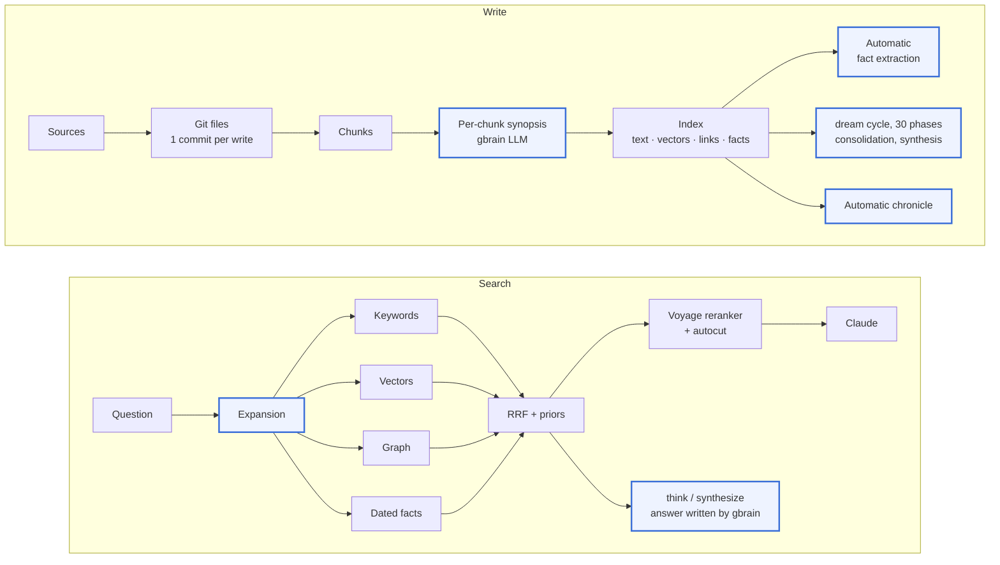
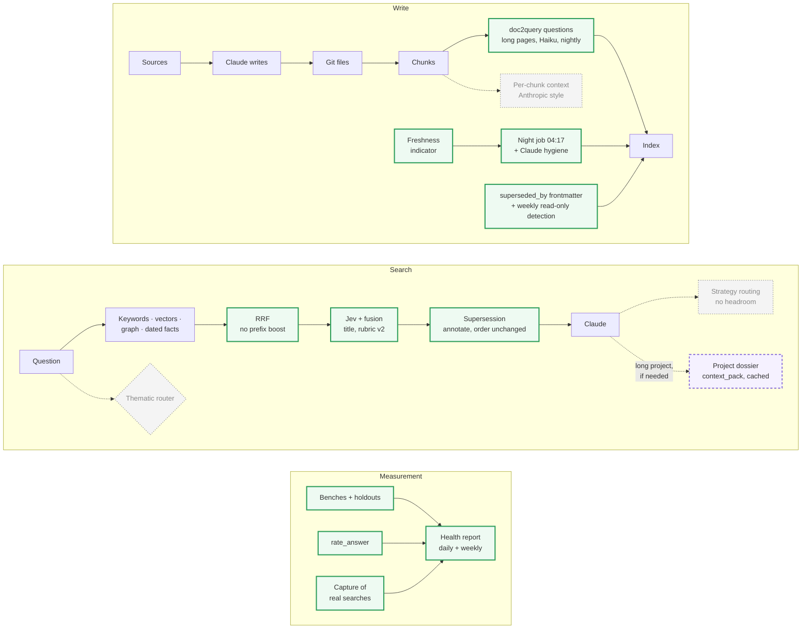
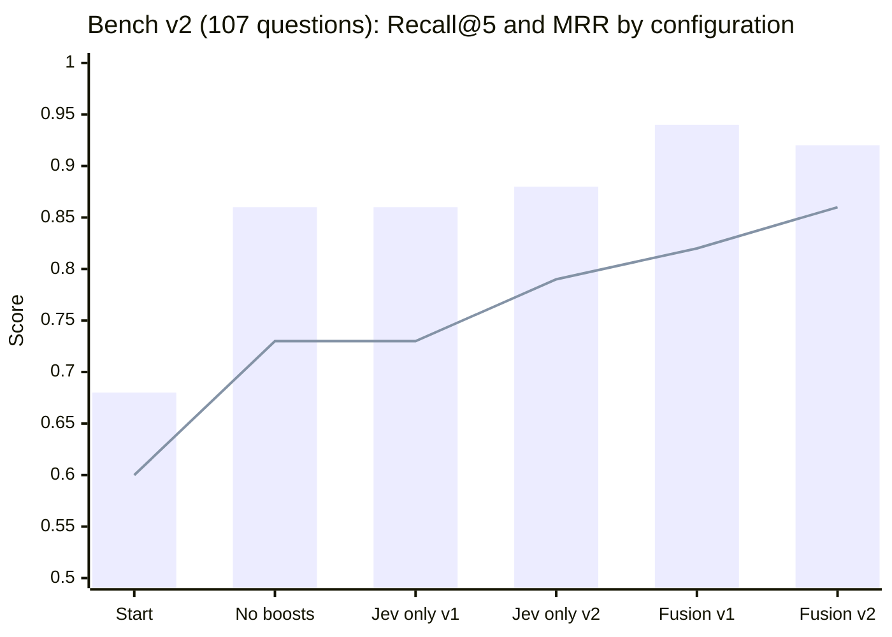
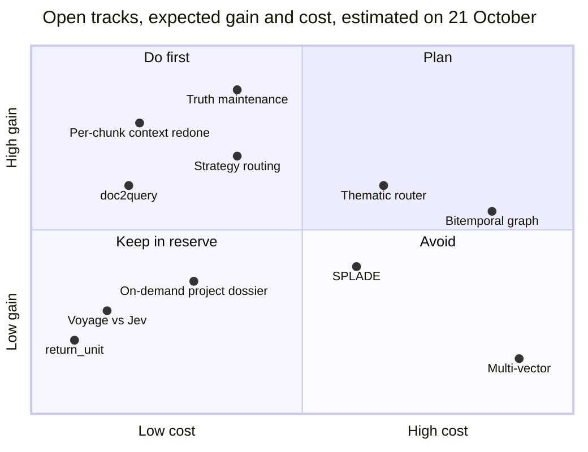

# Measure before adding: retrieval research on a personal gbrain

*Gabriel Kpodoh, with Claude (Anthropic). 21 October 2026, updated 23 October 2026 (§5 bis: three tracks measured, two shipped; strategy routing measured). One personal work brain, gbrain 0.48.1 then 0.60.340, on a fork of gbrain.*

> **Upstream.** gbrain is Garry Tan's project: [github.com/garrytan/gbrain](https://github.com/garrytan/gbrain). This work is a fork that measured and extended its retrieval on one real brain. "Native" in this paper means upstream gbrain. "Local patch" or "ours" means code or configuration added in the fork. The fork's working branch for this work is called `gbrain-2.0`; the name is the fork's, not an upstream release.

---

## Abstract

gbrain is a personal knowledge base that Claude queries over MCP. It holds Markdown pages, runs a hybrid search (keywords, vectors, graph) and keeps a memory layer (dated facts, a chronicle, skills for the agent). This paper compares three states of the same brain:

1. **gbrain 0.48.1**, the baseline;
2. **gbrain 0.60.340**, the latest release, installed on 21 October;
3. **the architecture we propose**, part of it live, part measured and dropped, part still to build.

The main contribution is a method, not a feature. We built a question bench with two holdouts, then measured each change before keeping it.

On the real brain (1,162 pages, 3,779 chunks), search goes from **0.68 / 0.60 / 0.58** (Recall@5 / MRR / nDCG@5) to **0.92 / 0.86 / 0.85** on 107 questions. On two holdouts never used for tuning, it reaches **0.91 / 0.84 / 0.83** and **0.92 / 0.89 / 0.88**.

The two largest gains are **diagnoses**, not additions:

- a ranking boost tuned for the gbrain author's own brain was crushing the factual pages;
- the reranker replaced the hybrid search order instead of complementing it.

Conversely, four well-known techniques brought nothing here, with measurements to show it:

- query expansion;
- Anthropic-style per-chunk context (redone on 2,500 chunks on 21 October: still no gain on the failure it targets);
- autocut;
- an iterative-search instruction for the agent.

The last part opens a research programme. Tracks are grouped by category: temporality, indexing, chunking, routing, ranking, session context. Each track is compared with the others in its category and with what already exists, with the protocol that would settle it.

**Update of 23 October (§5 bis).** The three priority tracks were measured in isolated lab copies, and strategy routing was measured end to end:

- **doc2query** (3 to 5 generated questions per chunk, added to the index) fixes the targeted failure. On 40 questions aimed at the middle of long pages, MRR goes from 0.51 to 0.71 with the reranker, with no loss on the usual benches. **Live since 23 October**: 0.78 / 0.70 / 0.72 on that bench, v2 unchanged at 0.92 / 0.84 / 0.84;
- **truth maintenance** finds stale pages (8 pairs out of 799 candidates), but demoting them in the ranking does not help: some questions look for them for their history. What is **live**: a `superseded_by` field set on the stale page and reported in results, without changing the order ("annotate");
- **the thematic router** is **dropped**: overview questions are rare (3 real requests in two months) and thematic summaries show no demonstrated gain;
- **strategy routing** has **no demonstrated headroom**. With the 2.0 changes live, the base agent scores 0.75 and 0.77 end to end. Taking the best of three runs of the same strategy per question gives 0.89, while an oracle that picks the best strategy per question gives only 0.77. The remaining errors are run-to-run variance and content, not strategy choice.

---

## Contents

1. [Context and method](#1-context-and-method)
2. [gbrain 0.48.1, the baseline](#2-gbrain-0481-the-baseline)
3. [gbrain 0.60.340, the latest release](#3-gbrain-060340-the-latest-release)
4. [The proposed architecture](#4-the-proposed-architecture)
5. [Open research](#5-open-research)
   - [5 bis. The measured tracks](#5-bis-the-measured-tracks-21-to-23-october)
6. [Limits](#6-limits)
7. [Conclusion](#7-conclusion)
8. [Appendices](#8-appendices)

---

## 1. Context and method

### 1.1 The brain under study

The brain is the author's work brain: a knowledge base built for his own job, mostly in French.

| Item | Value on 21/10/2026 |
|---|---|
| Active pages | 1,162, created since 8 July 2026 |
| Indexed chunks | 3,779 |
| Graph links | 6,949 |
| Knowledge pages (systems, projects, processes, people, concepts, originals) | 413 |
| Dated facts | 542, none marked as superseded |
| Content | Meeting notes, chat threads and direct messages, project, system, process and person pages, personal reflections ("originals") |
| Storage | Local Postgres + pgvector; pages as Markdown in a Git repository, one commit per write |
| Access | Local HTTP MCP server, run as a background service |
| Embeddings | OpenAI |

**Chunks by page type:**

| Type | Chunks | Pages split into 3 chunks or more | Mean chunk size |
|---|---|---|---|
| Chat thread | 950 | 124 | 1,321 characters |
| Project | 474 | 52 | 2,326 |
| Meeting | 442 | 68 | 2,120 |
| Direct messages | 423 | 52 | 1,204 |
| Original (personal reflection) | 382 | 56 | 1,647 |
| System | 347 | 57 | 1,998 |
| Concept | 208 | 23 | 2,144 |
| Process | 182 | 34 | 1,847 |
| Person | 154 | 17 | 1,679 |

### 1.2 The doctrine: "gbrain indexes, Claude reasons"

The doctrine was set on 2 September 2026. **gbrain never writes knowledge by itself.** The OpenAI key is used for embeddings only. Everything that reasons or writes goes through Claude, either in the author's sessions or non-interactively through his Claude subscription (`claude -p`).

Direct consequence: every gbrain function that depends on gbrain's own chat model is off or idle. That covers automatic fact extraction, the writing phases of the `dream` cycle, query expansion and per-chunk synopses.

### 1.3 Measurement protocol

**Question benches** (files `ops/eval/qrels*.json`):

| Bench | Questions | Composition | Use |
|---|---|---|---|
| v1 | 33 | Questions written from the pages | First tuning (included in v2) |
| v2 | 107 | 54 real queries taken from Claude Code sessions, 33 written, 10 in English, 10 short and vague | **Tuning** |
| Holdout A | 41 | 19 real queries, 7 in English, 10 vague, 5 aimed at an original | **Validation** of the chosen setting |
| Holdout B | 41 | Same composition | **Final measurement, opened once** |
| Multi-step | 22 | 6 bridge questions, 4 comparisons, 5 temporal, 7 missed by the final configuration | Agentic bench (§4.4) |
| Targeted chunk bench (added 21/10) | 40 | Answer in one specific chunk of a long page, never the first | doc2query track (§5 bis.1) |
| Overview bench (added 21/10) | 20 | 5 about a person, 4 about a period, 11 about a theme | Thematic router track (§5 bis.3) |

**Rule against overfitting:** tune on v2, validate on holdout A, open holdout B once. No question is shared between the three.

**Metrics:**

| Metric | What it measures |
|---|---|
| Recall@5 | Share of questions whose right page appears in the top 5 results |
| MRR | Rank of the right page: 1 if first, 0.5 if second, 0 if absent from the top 10. This is what the user sees day to day |
| nDCG@5 | Quality of the order of the top 5, main and secondary pages included |
| Judged score (agentic bench) | Correct answer = 1, partial = 0.5, wrong = 0, judged by Claude Haiku against a verified reference answer |

**Tools:**

- `gbrain eval --qrels` (native) for search;
- `ops/eval/run-bench.sh` to compare configurations;
- `ops/eval/agentic/run.py` and `judge.py` for end-to-end answers.

*Figure 1. The measurement protocol.*

---

## 2. gbrain 0.48.1, the baseline

gbrain 0.48.1 was released on 2 September 2026. It was the version in service until the morning of 21 October. The functions below were checked in the code at the tag `pre-upgrade-0.48-20261021`.

### 2.1 Architecture

*Figure 2. gbrain 0.48.1 as it ran here. Dashed: steps present in the code but idle. Search queries the index built at write time.*

### 2.2 What it does well

- **A complete hybrid search from day one.** Three lists (keywords, vectors, graph) fused by RRF, a robust method that ignores raw scores (Cormack et al., 2009). The intent classifier reweights the lists by question type.
- **A link graph** between pages: meeting attendance, topics discussed, mentions. It serves both search and navigation (`traverse_graph`, `get_backlinks`).
- **A dated memory layer already in place:**
  - facts with validity dates and a replacement link (`valid_from`, `valid_until`, `superseded_by`);
  - `remember` and `recall`;
  - `context_pack` and `volunteer_context`;
  - the Life Chronicle.
- **Measurement infrastructure already there**, but unused: `gbrain eval` with qrels, capture and replay of real searches, search telemetry, the MCP request log.
- **Search modes** (conservative, balanced, tokenmax) that set reranker, autocut, expansion and chunk context in one go.

### 2.3 Its defects

| # | Defect | Consequence here |
|---|---|---|
| B1 | **The default reranker, `zeroentropyai:zerank-2`, is an end-of-life provider** (hard-coded shutdown date: 4 September 2026, two days after the release) | No reranker at all: no key, then no provider |
| B2 | **Autocut on by default** in balanced and tokenmax. The gbrain team later measured that it cost recall (LongMemEval, 379 against 449 out of 470) and turned it off in 0.48.4 | None here: without a reranker, autocut cut nothing |
| B3 | **`query` forced expansion** in every mode, about 2 s more per query with a chat model | None here: without a chat model, expansion returned the question as is |
| B4 | **Ranking boost by slug prefix** (`originals/` ×1.5, `concepts/` ×1.3, `people/` ×1.2), tuned for the author's brain | Not diagnosed at the time (see §3.3) |
| B5 | **No revisions, no write queue.** Two sessions writing the same page step on each other | Risky concurrent writes |
| B6 | **No usage feedback** (`rate_answer` does not exist) | Ranking does not learn from use |
| B7 | **Everything that maintains memory depends on gbrain's chat model** | Under the doctrine, facts and chronicle stay almost empty |

---

## 3. gbrain 0.60.340, the latest release

Between 0.48.1 and 0.60.340 there are **356 releases in 49 days**, including 318 releases of 0.60.x in 23 days (about 14 a day). That is 8,284 commits, 119 new schema migrations (from 140 to 259) and a source tree grown from 1,175 to 3,208 files.

### 3.1 What 0.60 improves

| Theme | What 0.60 brings | Version | 0.48 defect fixed |
|---|---|---|---|
| Writes | **Managed mode with Git as source of truth**, revisions with conflict detection, write requests with acknowledgements and retries, `put_pages`, `edit_page`, `append_page` | 0.51.0 | B5 |
| Reranker | zerank-2 removed; **Voyage** by default (`rerank-2.5`, then `rerank-3-lite`, 60% cheaper for the same recall); **TypeSafe Jev** available through `gbrain decide` | 0.48.2, 0.60.26, 0.60.228 | B1 |
| Defaults | **Autocut off** everywhere; **expansion off** everywhere (p50 latency from about 2 s to 230 ms for 1 point of recall); `query` no longer forces expansion | 0.48.4, 0.60.188, 0.60.259 | B2, B3 |
| Ranking | New stages: multi-step relational planner (on), **dated facts added to `query` results** (`facts-arm`, on), per-page fusion, damping of highly linked pages, provenance-based demotion, rank priors, collapsing (on) | 0.48.4 to 0.60.332 | — |
| Usage feedback | **`rate_answer`** and a feedback loop that adjusts ranking by ±10% at most (off by default) | 0.60.63 | B6 |
| Chunk context | `return_unit` (window, section, page): return neighbouring chunks or the whole section | 0.60.13 | — |
| Storage | Segmented pages, up to 256 MiB | 0.60.290 to 0.60.299 | — |
| Memory | Automatic chronicle on by default (one paid chat call per page), `remember` with a validity date, `recall` ranked by question, explicit fact replacement | 0.60.45 to 0.60.169 | — |
| Night cycle | `dream` grows from 23 to 30 phases (repairs, contradictions, standing questions, chronicle) | — | — |
| Agent | Skills hosted in the brain, full tool surface by default (a bench showed that cutting the number of tools lowered success), standing questions, `wanted_pages`, `assemble_evidence` | 0.53, 0.60.115 | — |

### 3.2 gbrain 0.60 "everything on"

This is what 0.60 does with a chat-model key and a reranker key, in `balanced` or `tokenmax` mode:

*Figure 3. gbrain 0.60 with every option on. Blue: steps that call gbrain's chat model.*

### 3.3 Its defects, found in the code and measured on our base

**Design defects** (for any user):

| # | Defect | Evidence |
|---|---|---|
| D1 | **Heavy and fast-moving.** 259 migrations, about 14 releases a day, coordinated upgrades, simple operations refused in managed mode (renaming a page) | The 21/10 upgrade needed manual repairs: re-embedding, timelines, 13 stuck jobs. Renaming a person page was refused (`managed_remedy_unavailable`) |
| D2 | **Automatic maintenance depends on gbrain's chat model.** Writing phases of `dream`, fact extraction, chronicle, expansion, synopses | Without that model, only the agent-side skills remain, and nothing runs them on a schedule. Chronicle here: 5 pages processed |
| D3 | **Ranking priors tuned for another brain.** The slug-prefix boosts have not changed since 0.48 | Measured: see below |
| D4 | **A very large tool surface**: more than 100 MCP tools, several of which overlap for "find me something" | In sessions, about ten tools make most of the calls |
| D5 | **Cautious or off defaults**: usage feedback, autocut, expansion, reranking gate, and 7 of the 9 `decide` decisions | What you get depends on settings most users will not touch |
| D6 | **Frequent privacy fixes**: 16 releases mention them, including an exposure present "since 0.47" fixed in 0.60.268. With a TypeSafe key, the default decisions sent conversations and facts to the provider | We disabled `triage` and `conflict` |

**Configuration defects**, specific to our install:

| # | Defect | Evidence |
|---|---|---|
| C1 | No reranker | `search.reranker.enabled = false` |
| C2 | Chunk context limited to the page title, no expansion | Consequence of the doctrine |
| C3 | No measurement: `gbrain eval` exists, with no question bench | No qrels file |
| C4 | gbrain's agent-side skills are never used (`maintain`, `brain-ingest-gate`, `correction-pipeline`) | 0 calls to `get_skill` in sessions |
| C5 | No usage feedback: `rate_answer` never called | 0 calls |
| C6 | Fact layer almost empty | 542 facts, 0 superseded, 3 with an end date |

**Starting measurement on 0.60, original configuration:**

| Bench | Recall@5 | MRR | nDCG@5 |
|---|---|---|---|
| v1 (33 questions) | 0.58 | 0.47 | 0.49 |
| v2 (107 questions) | 0.68 | 0.60 | 0.58 |

**The decisive diagnosis (D3).** With `gbrain search --explain`, the top 6 results of every missed question were `originals/` pages. gbrain multiplies similarity by a boost that depends on the slug prefix. In its author's brain, `originals/` holds his own writing. Here, it holds 171 short, abstract reflection pages, which ranked ahead of the factual pages on every practical question.

---

## 4. The proposed architecture

### 4.1 Principle

The architecture rests on three ideas:

1. **gbrain stays the index; Claude stays the only one that reasons and writes.**
2. **Nothing goes live without a measurement**: bench, holdout, then health report.
3. **Add little.** What went live on 21 October mostly turns on or tunes native parts. What makes it different from standard gbrain are tracks chosen because they answer observed failures. By 23 October, two of them are live in a reduced form (doc2query, page-level truth maintenance in "annotate" mode), two were measured and dropped (per-chunk context, thematic router), strategy routing showed no headroom, and the project dossier is still to build.

*Figure 4. The proposed architecture as of 23 October. Green: live (since 21/10, doc2query and supersession since 23/10). Purple dashed: still to build. Grey dotted: measured and dropped.*

### 4.2 What is live, and what each change brought

| # | Change | Nature | Measured effect |
|---|---|---|---|
| 1 | **Prefix boosts disabled** (`search.source_boosts = none`) | Native setting | **Without a reranker: v1 recall from 0.67 to 0.92, v2 from 0.68 to 0.86.** The largest gain of the day |
| 2 | TypeSafe Jev reranker (`jev-1.13.0`) turned on | Native provider | +16 recall points on v1, neutral on v2 as long as it replaced the hybrid order |
| 3 | **Fusion of the Jev order with the hybrid order** (RRF, k = 20) | Local patch | **+8 recall points, +9 MRR points on v2** |
| 4 | **Jev scoring rubric spelled out** ("rubric v2") | Local patch | +2 recall points, +6 MRR points on v2 |
| 5 | Jev receives the page title before the chunk | Local patch | +3 points with Jev |
| 6 | 56 titles rewritten ("name — what it is for") | Content | +9 points without a reranker, nothing with Jev |
| 7 | French full-text search | Native setting | +3 points without a reranker, nothing with Jev |
| 8 | `rate_answer` turned on, rating instruction in `CLAUDE.md` | Native setting + instruction | Too recent to measure |
| 9 | Night hygiene: Claude refreshes the 5 syntheses furthest behind their timeline | Ours | Tested by hand on one page; first run on the night of 22/10 |
| 10 | Freshness indicator, health report, capture of real searches | Ours, on native logs | Starting point: 30 pages behind out of 413, 19 of them by more than 14 days |
| 11 | **doc2query** (since 23/10): 3 to 5 generated questions per chunk of long pages, in the embedding and full text | Ours, behind a native-style setting | **Targeted bench 0.57 / 0.51 / 0.53 → 0.78 / 0.70 / 0.72; v2 unchanged at 0.92 / 0.84 / 0.84** (§5 bis.1) |
| 12 | **Supersession "annotate"** (since 23/10): `superseded_by` in the frontmatter of stale pages, reported in results, order unchanged | Ours | v2 and holdout A identical by construction; the stale page leaves the agent's citations on the known failure (§5 bis.2) |
| 13 | Weekly read-only stale-page detection (Sundays) | Ours | Proposes pairs, applies nothing |

*Figure 5. Bars: Recall@5. Line: MRR. Fusion v2 is kept: 86 questions in first place against 77, for 2 fewer questions in recall.*

**Why fusion works.** On v2, 7 questions were found only without Jev, and 7 others only with it. Replacing the hybrid order with Jev's threw away half the signal. Reciprocal rank fusion keeps what each one finds. It reaches the theoretical recall ceiling, the best of the two for each question (0.94).

**Validation:**

| Bench | No reranker | Jev only, rubric v1 | **Kept configuration** |
|---|---|---|---|
| v2 (tuning) | 0.86 / 0.73 / 0.73 | 0.86 / 0.73 / 0.74 | **0.92 / 0.86 / 0.85** |
| Holdout A (validation) | 0.84 / 0.75 / 0.73 | 0.85 / 0.76 / 0.75 | **0.91 / 0.84 / 0.83** |
| Holdout B (once) | — | — | **0.92 / 0.89 / 0.88** |

Holdout scores are close to v2: nothing points to overfitting. The weekly bench of 21/10, with the live configuration, gives 0.92 / 0.84 / 0.84. The gap with 0.86 in MRR comes from Jev's variability from one call to the next. The same bench after doc2query went live on 23/10 gives the same 0.92 / 0.84 / 0.84.

### 4.3 What was tested and set aside

| Trial | Result | Explanation |
|---|---|---|
| Query expansion (Claude Haiku through the CLI) | 0.85 / 0.74 / 0.73 against 0.86 / 0.73 / 0.73; 12 questions better, 10 worse; about 5 s more per search | Consistent with the gbrain team's measurement (1 recall point for about 2 s). Along the way, `gbrain eval --expand` never called the model: bug fixed in the fork (`985a46f8e`) |
| Per-chunk context (Haiku, 7 pages, 21/10 morning) | No gain (−3 points, within noise) | Inconclusive at the time: 7 pages out of 1,162, and the missed questions were missed because of the boosts, not the context |
| Per-chunk context, redone on 2,513 chunks (21/10) | Targeted bench +0.02 MRR, within noise | Dropped: it describes the page, which rewritten titles already do (§5 bis.1). doc2query fixes the failure instead |
| Autocut | No effect on the metrics | It shortens the lists, which these metrics do not measure |
| Intent classifier off | MRR from 0.86 to 0.85 | Negligible either way |
| Demoting superseded pages after the reranker | Neutral (penalty) to harmful (substitution) | Some questions want the stale page for its history (§5 bis.2) |
| Thematic summaries and router | Gain within noise, 3 real overview requests in two months | Dropped (§5 bis.3) |
| Strategy routing | Oracle over strategies 0.77, no better than one base run | No headroom (§5 bis.4) |

### 4.4 Iterative search, measured end to end

The previous benches score a list of results. For multi-step questions, the answer has to be scored.

The agentic bench has Claude Sonnet answer 22 questions non-interactively, with read-only gbrain tools only. Claude Haiku judges each answer against a verified reference answer.

Why a judge rather than counting cited pages: in this brain, several pages often carry the same fact, so counting exact slugs underestimates correct answers.

| Variant | Correct | Partial | Wrong | Score | Searches | Duration |
|---|---|---|---|---|---|---|
| **No instruction** (Claude already chains 2 to 3 searches, as the gbrain server instructions ask) | 8 | 9 | 5 | **0.57** | 2.5 | 39 s |
| Instruction v1: decompose, search, rephrase, at most 3 rounds | 5 | 9 | 8 | 0.43 | 3.0 | 48 s |
| Instruction v2: one verified sentence per sub-question, dated facts by what they describe | 4 | 14 | 4 | 0.50 | 3.9 | 41 s |

**Score by question type:**

| Type | No instruction | v1 | v2 |
|---|---|---|---|
| Bridge (an intermediate person or system to find) | 0.42 | 0.42 | **0.50** |
| Comparison | 0.62 | 0.38 | 0.62 |
| Temporal | **0.90** | 0.60 | 0.50 |
| Missed by the final configuration | 0.43 | 0.36 | 0.43 |

**What we take from it:**

1. **Reading more pages exposes the agent to more stale pages.** With instruction v1, Claude read an older project page describing a superseded design of an agent, and its answer contradicted the current system page. The problem is in storage, not in search (§5.1).
2. **The same instruction helps one question type and hurts another.** This argued for routing by strategy rather than a single instruction (§5.4). *Measured on 23 October: the apparent differences were mostly run-to-run variance (§5 bis.4).*
3. **The date rule must apply to the fact, not the page.** A recent page can recall an old fact. The first draft of instruction v2 said the opposite; it was fixed before the measurement.

Each variant ran only once: with 22 questions, gaps of 0.07 are within noise.

### 4.5 The four tracks chosen on 21 October, and what became of them

Chosen for their link to an observed failure, to be measured before any go-live:

| Track | Failure it targets | What already exists | What had to be built | Outcome (23/10) |
|---|---|---|---|---|
| **Per-chunk context, redone properly** | Middle chunks of long pages (meetings, chat threads, projects) do not name their subject | Native mechanism (`per_chunk_synopsis`), Haiku model through the CLI | A bench of questions aimed at one chunk; context on the ~2,500 chunks of pages with 3 chunks or more | **Context dropped; doc2query shipped** in its place (§5 bis.1) |
| **Thematic router** | Overview questions ("what keeps coming up in my projects this quarter?") have no good page | Intent classifier (no measured effect), relational planner | Thematic summaries written by Claude; a router; an overview bench. First, count these questions in captured searches | **Dropped**: rare need, no demonstrated gain (§5 bis.3) |
| **Truth maintenance** | Duplicate or outdated pages that contradict each other (case seen in §4.4) | Fact validity and replacement fields (empty), chronicle (empty), provenance demotion | A page-level "superseded by" link, a canonical page per entity, and demotion of superseded pages in search | **Shipped as "annotate"**: detection and marking, no demotion (§5 bis.2) |
| **On-demand project dossier** | Long sessions on one project repeat the same searches | `context_pack` (native, never called), session-start hook | The rule that tells Claude when to load the dossier, rather than at every session | **Still to build** |

### 4.6 How the architecture answers the 0.60 defects

| Defect | Answer | Status |
|---|---|---|
| D3 / B4 · Priors tuned for another brain | `search.source_boosts = none` | Live; the largest gain |
| C1 · No reranker | Jev + fusion + title + spelled-out rubric | Live |
| C3 · No measurement | Benches, holdouts, agentic bench, health report | Live |
| C5 · No usage feedback | `rate_answer` on, rating instruction, export of ratings to the bench | Live, few ratings so far |
| D2 · Maintenance depends on gbrain's LLM | Night hygiene by Claude, non-interactive; nightly doc2query generation by `claude -p` | Live since 22/10 and 23/10 |
| C2 · Chunks without context | Rewritten titles; doc2query on long pages | Live since 23/10 |
| C6 · Empty fact layer | Page-level truth maintenance (`superseded_by`, annotate); fact-level rule for Claude | Page level live; fact layer still almost empty |
| C4 · gbrain skills unused | Hygiene covers stale syntheses; `maintain` and `brain-ingest-gate` still unused | Partly |
| D1 · Heavy and fast-moving | Pinned version, backup before upgrade, weekly replay of real searches to catch a regression | Mitigated; local patches to carry at every upgrade |
| D4 · Tool surface | Not addressed | Open |
| D6 · Privacy | TypeSafe `triage` and `conflict` decisions off; local-only capture | Mitigated |

---

## 5. Open research

Tracks are grouped into six categories. In each, every method is compared with the others in the same category and with what runs today. The protocols reuse the existing benches. They were written on 21 October before any new measurement. Where a track has since been measured (§5 bis), the outcome is added in the "Status here" column and after the protocol.

How to read the "Expected gain here" column:

| Label | Meaning |
|---|---|
| **Strong** | Targets a measured failure, cheap |
| **Medium** | Plausible, but the targeted failure is not measured yet |
| **Weak** | Overlaps with what already works |
| **Excluded** | Cost out of proportion with the expected gain |

### 5.1 Temporality and truth

**Question: how do we know what is true now, or at a given date, when the brain holds pages from different periods?**

| Method | Principle | Status here | Compared with what exists | Expected gain here |
|---|---|---|---|---|
| Night hygiene (ours) | Claude rewrites syntheses that lag behind their timeline | Live | Fixes a page, but never says that **another** page is outdated | — (reference) |
| Life Chronicle (native) | Log of dated events: "what happened on that day?" | 5 pages processed: it depends on gbrain's LLM | Events are added, never invalidated. It would not have prevented the §4.4 error, because the faulty page is not an event | Weak, except as a trigger |
| Dated facts (native) + `facts-arm` | Facts with validity date and replacement, added to `query` results | 542 facts, 0 superseded | The right mechanism at the right grain, but empty. Filling it is a working rule for Claude, not code | Medium |
| **Page-level truth maintenance** | One canonical page per entity; a "superseded by" link; search demotes superseded pages | **Shipped 23/10 as "annotate": marking and reporting, no demotion** | **The only method that targets the observed failure directly**: two pages about the same agent, one stale | **Strong** → measured: detection works, demotion does not help |
| Bitemporal temporal graph (Zep / Graphiti, Rasmussen et al., 2025) | Each edge has a validity date and a recording date; a new fact invalidates the old one explicitly | No | The full version of the previous row, but it needs a model that extracts facts at every write, which goes against the doctrine | Medium, costly |

**Protocol (21/10).** Replay the 5 temporal questions and the 6 bridge questions of the agentic bench, after marking the known duplicates (for example, an older project page describing a superseded design of an agent, against the current system page). We expect the wrong answers caused by a stale page to disappear.

To find duplicates there are several sources: the freshness indicator, `find_contradictions` (native) and a Claude pass over pairs of pages that are very close in embedding.

**Outcome (§5 bis.2).** Detection by embedding neighbours plus Claude found 8 reliable pairs out of 799 candidates. On the known failure, the stale page leaves the agent's citations. Demotion was neutral on the benches, because a superseded page stays the right answer for its own history. What shipped is the marking, reported to the agent, with the ranking unchanged.

### 5.2 Indexing and chunk representation

**Question: in what form should a chunk be indexed so that a question finds it?**

| Method | Principle | Status here | Compared with what exists | Expected gain here |
|---|---|---|---|---|
| Page title as context (native) | The title is added to every chunk | Live | — | — (reference) |
| Rewritten titles | "name — what it is for" instead of the slug | Live | +9 points without a reranker, nothing with Jev: the reranker already partly compensates | — (measured) |
| **Per-chunk context** (Anthropic, *Contextual Retrieval*, 2024) | A sentence placing the chunk in its page, added before indexing. Anthropic: −35% retrieval failures, −49% with contextual full text too, −67% with a reranker | **Redone on 2,513 chunks: +0.02 MRR on the targeted bench, within noise. Dropped** | Targets middle chunks that do not name their subject. Short syntheses already have the title; long meetings and chat threads do not | **Strong** (priority) → measured: no gain on the target |
| **doc2query** (Nogueira et al., 2019; doc2query−−, Gospodinov et al., 2023) | Generate for each chunk the 3 to 5 questions it answers, and index them with it | **Shipped 23/10** | Direct competitor of per-chunk context: one describes the chunk, the other brings it closer to the shape of questions. Our queries are almost always questions | Medium to strong, **to be settled against the previous row** → measured: +0.20 MRR on the target |
| French full text | French stemming in Postgres | Live | +3 points: full text requires every word of the question (logical AND), language was not the problem | — (measured) |
| Learned sparse retrieval (SPLADE, Formal et al., 2021) | A model weights and expands terms | No | Would replace the logical AND with a weighted match, with synonyms | Medium |
| Multi-vector (ColBERT, Khattab & Zaharia, 2020) | One vector per token, late interaction | No | 10 to 100 times the storage, for a gain the reranker already brings | Excluded |
| Changing the vector metric | Cosine, dot product, L2 | No | OpenAI embeddings are normalised: the three metrics rank the same | Excluded |

**Protocol (21/10): one bench, four variants.**

1. Write 40 questions whose answer is in one specific chunk of a long page, never the first, phrased without the title's words.
2. Index the ~2,500 chunks of pages split into 3 pieces or more, in four variants: (A) title only, (B) per-chunk context, (C) doc2query, (D) B + C.
3. Measure on those 40 questions, and on the 107 of v2 to check that nothing regresses.

Estimated cost: about 2,500 Haiku calls per variant through the subscription, and a few cents of re-embedding. Actual cost was lower: one call per page, 548 calls in total for all variants (§5 bis.1).

**Outcome (§5 bis.1).** Six index states were measured, not four (two placements added to separate vector and full-text effects). doc2query in both the embedding and full text is the only state that fixes the targeted failure.

### 5.3 Chunking

**Question: which unit should be indexed, and which unit returned to Claude?**

| Method | Principle | Status here | Compared with what exists | Expected gain here |
|---|---|---|---|---|
| Current chunking (native) | Pieces of 1,200 to 2,300 characters on average, aligned on Markdown structure | Live | — | — (reference) |
| "Search small, return big" (native: `return_unit`) | Find a chunk, return its window, section or page | Available since 0.60.13, never tuned | Already native: testing it costs one setting. Overlaps with per-chunk context, which brings context at indexing rather than at return | Weak to medium, **to prove itself against per-chunk context** |
| Atomic propositions (*Dense X Retrieval*, Chen et al., 2023) | Index elementary statements rather than passages | No | More precise for factual questions, but multiplies units, and the reranker sees fragments | Medium |
| Late chunking (Günther et al., 2024) | Embed the whole page, then split the vectors | No | Page context flows into each vector with no LLM call. Needs a long-context embedding model, different from OpenAI's. About 2 points in published results | Weak |
| Summary tree (RAPTOR, Sarthi et al., 2024) | Recursive summaries of chunk groups, indexed with them | No | The basis of the thematic router (§5.4): to be evaluated with it | See §5.4 |

**Protocol.** Set `return_unit` to `section`, then to `window`, and replay the agentic bench. It is the only bench that sees the effect, since search finds the same page and only the text returned to Claude changes. To do after §5.2, to know what doc2query already covers. *Not run yet.*

### 5.4 Routing

**Question: should every question be handled the same way?**

| Method | Principle | Status here | Compared with what exists | Expected gain here |
|---|---|---|---|---|
| Intent classifier (native) | Reweights the lists by question type | Live | Turning it off changes nothing (MRR from 0.86 to 0.85) | — (measured) |
| Relational planner (native) | Decomposes bridge questions into graph walks | Live by default | Not measured in isolation. Bridge questions were the weakest of the agentic bench on 21/10 (0.42) | To measure |
| **Thematic router** (GraphRAG, Edge et al., 2024; LightRAG, Guo et al., 2024; RAPTOR) | Overview questions go to thematic summaries; the others to normal search | **Built in the lab, dropped** | GraphRAG shows a clear gain on "global sensemaking" questions, and none on precise questions. Everything depends on the share of such questions here | **Medium to strong**, depending on their frequency → measured: 0.8% to 2.4% of searches, gain within noise |
| **Strategy routing** (Adaptive-RAG, Jeong et al., 2024) | A classifier chooses: one search, iterative search, or a date filter | **Measured 23/10: no headroom** | Our bench seemed to justify it: the iterative instruction helped bridge questions (0.42 → 0.50) and hurt temporal ones (0.90 → 0.50) | **Strong**, data in hand → measured: oracle 0.77 vs one base run 0.75–0.77 |
| Separating episodic from semantic memory (A-MEM, Xu et al., 2025; Letta; Mem0) | Episodic memory (meetings, chat, dated) and semantic memory (syntheses) queried according to the question | No | One routing criterion among others: merges into the two rows above | Merged into routing |
| Corrective gate (CRAG, Yan et al., 2024; native, off) | If results look weak, search again or widen | Available, off | Overlaps with engine-side iterative search | Weak |

The two routers do not exclude each other. One can route by grain first (overview or precise question), then by strategy.

**Protocol (21/10).**

1. **Frequency.** With the capture of real searches, on since 21/10, count the share of overview and bridge questions.
2. **Thematic router.** Write 20 overview questions with their expected elements, and compare on the agentic bench: (A) no summaries, (B) summaries indexed with the rest, no router, (C) summaries behind the router. Variant B tests the fear that summaries pollute precise questions.
3. **Strategy routing.** Replay the 22 multi-step questions with the strategy chosen by the classifier. We expect the best of both columns of §4.4: at least 0.50 on bridge questions and 0.90 on temporal ones.

**Outcome.** Frequency was measured from the query cache and from Claude Code transcripts rather than waiting two weeks (§5 bis.3). The thematic router was built and dropped. Strategy routing was settled without building a classifier: an oracle that picks the best strategy per question does no better than a single base run, so a real classifier cannot either (§5 bis.4).

### 5.5 Ranking and search techniques

**Question: how should candidates be ordered, and how many times should we search?**

| Method | Principle | Status here | Result or comparison | Expected gain here |
|---|---|---|---|---|
| RRF, k = 60 (native) | Reciprocal rank fusion | Live | Robust, no tuning | — (reference) |
| Weighted fusion | Weights per list instead of RRF | No | Often weak behind a reranker | Weak |
| **Reranker + hybrid fusion** (local patch) | Jev's order and the hybrid order fused by RRF, k = 20 | Live | +8 recall points, +9 MRR; reaches the theoretical ceiling | — (measured) |
| Voyage `rerank-3-lite` reranker (native 0.60 default) | Hosted cross-encoder | Not tested | The gbrain team measures it better than Jev on its benches; we have not compared | Medium: an A/B to run on our benches |
| Query expansion (native) | Several phrasings of the question | Tested, off | No gain, +5 s | — (measured) |
| HyDE (Gao et al., 2022) | Search with a hypothetical answer rather than the question | No | Close to expansion, and doc2query does the same on the index side, once and for all | Weak |
| Agent-side iterative search (IRCoT, Trivedi et al., 2023) | Search, read, rephrase, repeat | Tested: two instructions, neither beats the current habit | Useful only for some question types, if any: see routing | Via routing → measured: no headroom |
| Usage feedback (native) | `rate_answer` ratings adjust ranking by ±10% | On | The gbrain team measures +2 nDCG@10 points on entity-centred brains. Here: too few ratings so far | To measure in a month |
| Supersession step after the reranker (local patch) | Annotate, penalise, put behind or substitute superseded pages | **Live in "annotate"** | Native `supersedes` demotion acts before the reranker, which undoes it | — (measured, §5 bis.2) |

### 5.6 Session context

**Question: what should Claude know before it even searches?**

| Method | Principle | Status here | Compared with what exists | Expected gain here |
|---|---|---|---|---|
| Session-start hook (live) | Injects a few recent facts | Live | Light, no cost | — (reference) |
| Query cache (native) | Reuses the answer to a close question | Live | 856 questions kept, 5 reused in three months: useless for a personal brain | Excluded |
| Systematic CAG (Chan et al., 2024) | Load the whole project into context at every session | No | 50,000 to 100,000 tokens per session, even with no question; quality drops in long context (*Lost in the Middle*, Liu et al., 2023; *Context Rot*, Chroma, 2025) | Set aside |
| **On-demand project dossier** | Claude calls `context_pack` when it judges the session long on one project; prompt caching keeps the dossier | To build | Keeps the advantage of CAG without its fixed cost | Medium |
| Sleep-time compute (Letta, 2025) | Prepare syntheses and likely answers overnight | Partly: night hygiene and nightly doc2query are forms of it | Natural extension of the night job | Medium |

**Protocol.** In the agentic bench, on 15 questions about the same project asked in a single session, compare the dossier loaded at the start, the dossier loaded on demand, and no dossier. Measure correctness, number of searches and tokens consumed. *Not run yet.*

### 5.7 Synthesis: where to start

*Figure 6. Positions estimated on 21 October, before measurement. The measured outcomes are in the table below: two of the four "do first" tracks gave nothing, and the one estimated lowest of the four (doc2query) gave the largest gain.*

| Track | Estimated (21/10) | Measured (23/10) |
|---|---|---|
| Truth maintenance | Strong gain, low cost | Detection works; demotion neutral; shipped as annotate |
| Per-chunk context redone | Strong gain, low cost | No gain on the target; dropped |
| Strategy routing | Strong gain, low cost | No headroom; dropped |
| doc2query | Medium to strong gain, low cost | +0.20 MRR on the target, neutral elsewhere; shipped |
| Thematic router | Medium to strong gain, higher cost | Rare need, gain within noise; dropped |

**Proposed order, with outcomes:**

1. **Per-chunk context against doc2query**, on a bench aimed at specific chunks (priority chosen on 21/10). *Done: doc2query wins and is live (§5 bis.1).*
2. **Truth maintenance**, aimed at the failure seen in §4.4. *Done: marking and reporting live, no demotion (§5 bis.2).*
3. **Strategy routing against thematic router**, once the frequency of question types is known from the capture. *Thematic router done and dropped (§5 bis.3); strategy routing measured on 23/10, no headroom (§5 bis.4).*
4. Cheap native settings to test along the way: `return_unit` and Voyage against Jev. *Not run yet.*
5. The on-demand project dossier. *Not run yet.*

---

## 5 bis. The measured tracks (21 to 23 October)

Each track ran in its own Claude Code session and on its own copy of the brain, then on fresh native lab brains (`gbrain init --db-only`, content imported from a snapshot, graph links copied over). Reference checked in these labs on v2: 0.87 / 0.73 / 0.73 without Jev, 0.94 / 0.85 / 0.85 with Jev. Holdout B was never reopened. Full reports: `ops/eval/chunk/`, `ops/eval/truth/`, `ops/eval/router/`.

### 5 bis.1 Indexing: doc2query wins, per-chunk context does not

**What 0.60 offers.** The native mechanism builds the embedding text at call time as `<context>{title}\n{synopsis}\n</context>\n{chunk}`. It is never written to the stored chunk text: full text, Jev and snippets only see the original chunk. `per_chunk_synopsis` makes gbrain's chat model generate one sentence of 15 to 30 words per chunk, cut at 300 characters, one call per chunk. There is no native doc2query and no entry point for indexing text produced outside gbrain. Worse, re-embedding a page (`embed --stale`, `embed --all`, backfill, or re-import of a changed page) rebuilds it in the global mode, so any externally enriched vector silently disappears at the next re-embedding.

**Targeted bench** (`ops/eval/chunk/qrels-chunk.json`): 40 questions whose answer is in one specific chunk of a page with 3 chunks or more, never the first, phrased without the title's words. Chunks were drawn at random (fixed seeds) among chunks of 600 characters or more: 8 meetings, 9 chat threads, 5 direct messages, 5 projects, 7 systems, 2 processes, 2 concepts, 2 people. Each question was checked: its evidence terms are in the target chunk, absent from the page's other chunks (lead summary and timeline included) and absent from every other page. 94 candidate chunks were read to keep 40, about fifteen after rephrasing.

The current state is weak there, which confirms the failure: 0.38 / 0.27 / 0.29 without Jev and 0.57 / 0.51 / 0.53 with Jev, against 0.87 / 0.73 / 0.73 and 0.90 / 0.79 / 0.80 on v2 in the same lab.

**Generation.** One Claude Haiku call per page for all its chunks (548 calls for 494 pages and 2,513 chunks; groups of at most 14 chunks; above 45,000 characters, the start of the page plus the group's chunks, by 8). Output per chunk: one context sentence (B) and 3 to 5 questions (C). Replayable cache. Volume: 4.1 M input tokens, 2.7 M output tokens, $2.16 in API equivalent, about 80 minutes at 6 calls in parallel. A random sample of 12 chunks was checked by hand: 12 faithful, no invention. An early prompt produced sentences like "does not deal with X", which inject off-topic terms; fixed by the prompt and by a deterministic filter at indexing.

**Index states:**

| State | Embedding | Full text |
|---|---|---|
| A | title (current state) | chunk |
| B | title + context sentence | chunk + context |
| C | title + doc2query questions | chunk + questions |
| D | title + context + questions | chunk + context + questions |
| E | title + context | chunk + questions |
| F | title (unchanged) | chunk + questions |

**Results without Jev** (Recall@5 / MRR / nDCG@5):

| State | Targeted (40) | v2 (107) | Holdout A (41) |
|---|---|---|---|
| A · title only | 0.38 / 0.27 / 0.29 | 0.87 / 0.73 / 0.73 | 0.84 / 0.75 / 0.74 |
| B · context, embedding | 0.42 / 0.29 / 0.32 | 0.86 / 0.73 / 0.74 | 0.84 / 0.74 / 0.74 |
| B · context, embedding + full text | 0.42 / 0.29 / 0.32 | 0.87 / 0.74 / 0.75 | 0.84 / 0.74 / 0.74 |
| C · doc2query, embedding | 0.60 / 0.47 / 0.50 | 0.88 / 0.72 / 0.73 | 0.84 / 0.76 / 0.76 |
| **C · doc2query, embedding + full text** | **0.65 / 0.50 / 0.53** | 0.88 / 0.72 / 0.72 | 0.84 / 0.77 / 0.76 |
| D · B + C, embedding | 0.50 / 0.37 / 0.39 | 0.86 / 0.74 / 0.74 | 0.83 / 0.75 / 0.74 |
| D · B + C, embedding + full text | 0.50 / 0.38 / 0.40 | 0.85 / 0.76 / 0.75 | 0.83 / 0.75 / 0.74 |
| E · context in embedding, questions in full text | 0.45 / 0.33 / 0.35 | 0.86 / 0.73 / 0.74 | 0.84 / 0.74 / 0.74 |
| F · questions in full text only | 0.38 / 0.29 / 0.30 | 0.87 / 0.73 / 0.73 | 0.84 / 0.75 / 0.74 |

**Results with Jev + fusion**, as in service (mean of two runs):

| State | Targeted (40) | v2 (107) | Holdout A (41) |
|---|---|---|---|
| A · title only (before) | 0.57 / 0.51 / 0.53 | 0.90 / 0.79 / 0.80 | 0.89 / 0.85 / 0.83 |
| B · context sentence (Anthropic) | 0.58 / 0.53 / 0.54 | 0.93 / 0.82 / 0.82 | 0.89 / 0.86 / 0.85 |
| **C · doc2query, embedding + full text** | **0.73 / 0.71 / 0.71** | 0.92 / 0.81 / 0.81 | 0.90 / 0.81 / 0.82 |
| D · B + C | 0.69 / 0.66 / 0.66 | 0.91 / 0.82 / 0.82 | 0.88 / 0.82 / 0.82 |
| E · context in embedding, questions in full text | 0.67 / 0.59 / 0.60 | 0.92 / 0.83 / 0.82 | 0.89 / 0.86 / 0.84 |
| F · questions in full text only | 0.61 / 0.55 / 0.56 | 0.90 / 0.80 / 0.81 | 0.88 / 0.84 / 0.83 |

**Paired differences against A, with Jev** (bootstrap, 10,000 draws over questions; regular benches = v2 + holdout A, 148 questions):

| State | Bench | Δ Recall@5 [95% CI] | Δ MRR [95% CI] |
|---|---|---|---|
| B | targeted | +0.013 [−0.062; +0.087] | +0.016 [−0.069; +0.100] |
| B | regular | +0.017 [−0.011; +0.049] | +0.029 [+0.004; +0.055] |
| **C** | **targeted** | **+0.163 [+0.050; +0.287]** | **+0.200 [+0.090; +0.321]** |
| **C** | **regular** | +0.014 [−0.022; +0.051] | −0.002 [−0.039; +0.033] |
| D | targeted | +0.113 [+0.000; +0.237] | +0.145 [+0.041; +0.261] |
| D | regular | +0.005 [−0.029; +0.039] | +0.013 [−0.021; +0.046] |
| E | targeted | +0.087 [+0.013; +0.188] | +0.084 [+0.000; +0.182] |
| E | regular | +0.012 [−0.015; +0.043] | +0.029 [+0.004; +0.056] |
| F | targeted | +0.037 [−0.025; +0.125] | +0.036 [−0.004; +0.100] |
| F | regular | −0.004 [−0.010; +0.000] | +0.003 [−0.007; +0.012] |

Without Jev, C also wins clearly on the targeted bench (MRR +0.23, CI [+0.14; +0.33]) and stays neutral on the regular benches (−0.006, CI [−0.03; +0.02]).

Jev noise, measured on A between its two runs: MRR changes on 1 question of the targeted bench, 9 of v2 and 4 of holdout A. Latency did not change: without Jev, 0.35 and 0.36 s per question for A, 0.37 and 0.33 s for C; with Jev, 0.61 and 0.62 s for A, 0.64 and 0.71 s for C.

**Reading.**

1. A middle chunk does not name its subject, but it answers a question. Bringing the chunk closer to the shape of a question is what makes it rise. The context sentence describes the page, which our rewritten titles already do, and Jev already sees the title.
2. The gain goes through the vector. In full text alone (F), the questions are almost useless, because of the logical AND.
3. Mixing context and questions in the same vector (D) dilutes them: 5 MRR points below C on the targeted bench.
4. The cost of C is a slight loosening of top places on holdout A with Jev (2 questions up, 6 down; MRR 0.85 → 0.81): pages move from first to second or third because other pages now carry close generated questions. Over the 148 regular questions the effect is nil.
5. A lexical-overlap control (Jaccard between bench questions and generated questions) does not change the conclusion. On the 26 questions with low overlap (Jaccard < 0.30), MRR without Jev goes from 0.28 to 0.52; on the other 14, from 0.26 to 0.47.

**Integration and control.** gbrain had nowhere to keep indexing text produced outside it: a re-embedding would have erased the questions. Hence:

- a `chunk_index_text` table keyed on the chunk's sha256 fingerprint (migration 265), so a chunk whose text changes loses its questions until the next generation;
- wiring into every embedding path (import and sync, `embed <slug>`, `--all`, `--stale`, backfill, the managed-mode embedding worker, the context service, segmented pages) and into full text (weight C, the chunk staying at weight B);
- all behind the database setting `search.chunk_index_text = d2q`, off by default, and byte-for-byte identical to before when off (checked by tests). A database setting rather than an environment variable, so that every process (sync, server, night cycle, CLI) sees the same value;
- a `gbrain chunk-text` command (`status`, `pending`, `import`, `refresh`, `prune`);
- nightly generation by `claude -p`, at most 40 calls a night. gbrain still calls no chat model.

Control measurement with the integrated code, on a fresh native lab (1,173 pages, 3,813 chunks; 2,424 question texts on 491 pages imported from the 21/10 cache, no new call):

| State | Targeted (40) | v2 (107) | Holdout A (41) |
|---|---|---|---|
| off, no Jev | 0.40 / 0.29 / 0.31 | 0.87 / 0.73 / 0.73 | 0.84 / 0.75 / 0.73 |
| **on, no Jev** | **0.63 / 0.50 / 0.52** | 0.86 / 0.70 / 0.71 | 0.84 / 0.77 / 0.75 |
| off, with Jev | 0.48 / 0.41 / 0.41 | 0.94 / 0.85 / 0.85 | 0.90 / 0.83 / 0.82 |
| **on, with Jev** | **0.75 / 0.67 / 0.69** | 0.94 / 0.83 / 0.83 | 0.88 / 0.83 / 0.81 |

| Mode | Bench | Δ Recall@5 [95% CI] | Δ MRR [95% CI] | Up / down (MRR) |
|---|---|---|---|---|
| no Jev | targeted | +0.225 [+0.100; +0.350] | +0.208 [+0.117; +0.310] | 18 / 0 |
| no Jev | regular (148) | −0.005 [−0.030; +0.020] | −0.013 [−0.039; +0.012] | 14 / 17 |
| with Jev | targeted | +0.275 [+0.150; +0.412] | +0.265 [+0.149; +0.388] | 16 / 2 |
| with Jev | regular (148) | −0.011 [−0.035; +0.008] | −0.017 [−0.048; +0.014] | 13 / 17 |

Go-live criteria set in advance: targeted MRR with Jev at least 0.65 (**0.67, met**), and no more than 0.02 MRR lost on v2 + holdout A (**−0.017, met narrowly**, interval down to −0.048). The negative sign repeats across labs, so it is watched in the weekly bench and the replay of real searches. Two fixes came out of this measurement: `chunk-text refresh` continues after a page fails, and exits non-zero when failures remain.

**Live on 23 October** (2,400 questions on 488 pages): targeted bench **0.78 / 0.70 / 0.72**, v2 **0.92 / 0.84 / 0.84**, identical to the weekly bench of 21/10. Cost: $2.16 in API equivalent for the full generation (subscription), $0.24 of embeddings, no added latency. Nightly upkeep: about 4.6 long pages are created per day, so 5 to 15 Haiku calls a night, capped at 40.

### 5 bis.2 Temporality: find stale pages, report them without demoting them

**What 0.60 already offers.** Facts carry `superseded_by`, `valid_until` and `expired_at`, and `recall` and `facts-arm` already skip superseded facts. But `remember` only sets `superseded_by` when the new fact is almost word for word the old one (same entity, same kind, cosine above the dedup threshold), hence 0 superseded facts out of 542. Native `supersedes` links apply a ×0.5 penalty **before** the reranker, so Jev and the RRF fusion partly put the stale page back in front. There were no `supersedes` links in the brain anyway.

**Detection** (read-only, Claude as the only judge), on the 425 knowledge pages:

| Step | Method | Result |
|---|---|---|
| Candidates | 6 nearest neighbours of each page by mean embedding (similarity ≥ 0.78, person/person pairs excluded), plus shared aliases and pages that declare themselves outdated | 799 pairs (770 neighbours, 76 banners, 13 aliases) |
| Triage | Claude Sonnet, batches of 40 short cards, broad instruction | 354 pairs |
| Judgement | Claude Sonnet, both full pages, freshness attached | 240 complementary, 99 distinct, 14 superseded, 1 duplicate |
| Confirmation | Claude Opus, blind re-judgement of the 15 | 11 confirmed (same verdict and direction) |
| Kept for the lab | Mean of the two confidences ≥ 0.8; superseded page not dated; one proposal per page | **8** |

The 8 pairs, described by kind (confidence in brackets):

| Superseded page | Page that holds | Contradiction found (summary) |
|---|---|---|
| A personal reflection (0.92) | A dated project status page | Describes an earlier version of a method that was later replaced |
| A project page (0.91) | A later project status page | Presents an older version as current |
| A process page (0.91) | A project page | States itself that it is no longer the current state |
| A project page (0.88) | A system page | Describes an implementation that was later rebuilt elsewhere |
| A project page (0.87) | A system page | Describes as off a feature that was switched on since |
| An older project page describing an agent (0.85) | The agent's current system page | Describes a superseded design of the agent |
| A personal reflection (0.84) | A later reflection | Describes as present a detail that was removed since |
| A personal reflection (0.82) | A more complete reflection | Duplicate of the same insight |

Every verdict cites the precise contradiction. The known pair (the older agent-design page, §4.4) comes out through the neighbourhood at a similarity of 0.825. A global similarity threshold would have missed it: pages about different people sit at 0.91. Pages that declare themselves outdated mostly serve as confirmation (1 of the 8). A page can be outdated **on one point only**; a "superseded by" link does not fit then, and the sentence should be fixed instead. Dated pages (meetings, chat threads, "status as of" pages) are never superseded: they are archives, and their age is handled by their date. Cost: about 450 `claude -p` calls, no call to gbrain's model.

**Convention.** `superseded_by: <slug>` in the frontmatter of the superseded page means "for the current state of this subject, read `<slug>`". The page stays valid as history and is never deleted. An optional `canonical: true` marks the reference page; nothing reads it in search yet.

**Code.** A new step after the reranker and RRF fusion (`src/core/search/hybrid/supersession.ts`, one line of wiring), off by default, with `GBRAIN_SUPERSEDE` choosing the variant: `annotate` (order unchanged, the row carries `superseded: true` and `superseded_by`), `penalty` (rank divided by a factor, on ranks because reranker and fusion scores have different scales), `behind` (the holding page takes the place, the stale page follows), `substitute` (the stale page leaves the list). A canonical page the caller cannot read is never named. On error, results go out unchanged. 8 tests, all green.

**Demotion**, measured after the reranker:

| Variant | v2 with Jev | Holdout A with Jev |
|---|---|---|
| Before | 0.94 / 0.86 / 0.85 | 0.91 / 0.83 / 0.82 |
| `annotate`: order unchanged, the stale page carries `superseded_by` | identical | identical |
| Native `supersedes` links, ×0.5 before the reranker | 0.92 to 0.93 / 0.83 / 0.83 | 0.90 to 0.91 / 0.82 / 0.81 to 0.82 |
| `penalty` ×0.5 | 0.95 / 0.85 / 0.85 | 0.90 / 0.82 / 0.82 |
| `penalty` ×0.25 | 0.95 / 0.83 / 0.83 to 0.84 | 0.91 / 0.82 to 0.83 / 0.82 to 0.83 |
| `behind`: the current page takes the place | 0.94 / 0.84 / 0.84 | 0.90 / 0.82 / 0.81 |
| `substitute`: the stale page leaves | 0.91 / 0.83 / 0.82 | 0.90 / 0.82 / 0.82 |

**Why nothing wins.** A "superseded" page is superseded only for the **current state**. Without Jev, where everything is deterministic, the ×0.5 penalty changes 9 questions of v2: 5 go up (the right page moves ahead; one question goes from MRR 0.50 to 1.00), and 4 go down, exactly those that expect the old page for its history or design (questions about the history or the earlier design of a topic). Substitution drops the first three of those to 0. No bench question opposes a stale page to its replacement.

**On the known failure (question mh-06)**, the stale page disappears from the citations: 2 answers out of 2 before, 0 out of 4 after. In one `annotate` answer, Claude writes it itself: the two older pages are marked as superseded by the system page, which it therefore used. The judged score cannot settle it: ±0.15 of noise between two identical runs, a Haiku judge that marks correct answers as wrong, and quota exhausted before a second judge could run.

**Live on 23 October:** the `superseded_by` frontmatter convention, the `annotate` variant (`GBRAIN_SUPERSEDE=annotate`), and 5 pages marked after the author's review. The 3 proposals on personal reflections were left aside: they are the author's own thinking, and one proposal looked inverted. The marking rule was added to the end-of-session skill, with four conditions: same subject; a verifiable contradiction about the current state, cited in the old page's timeline; never a dated archive; and if only one sentence is outdated, fix the sentence instead. A weekly read-only detection proposes new pairs every Sunday and applies nothing.

### 5 bis.3 Routing: the thematic router is dropped

**Frequency first.**

| Source | Content | Usable? |
|---|---|---|
| Query cache | 832 distinct queries sent to gbrain from 9 July to 21 October | Yes, main source. 76 bench queries removed, 756 kept |
| Eval candidates | 261 queries, all from 21/10, almost all from the agentic bench | As a control only |
| MCP request log | 964 `search`/`query` calls since 2 September | No: parameters masked, only volume readable |
| Claude Code transcripts | The requests that triggered those searches | Yes: 401 calls up to 21/10; counts and paraphrased examples only |

| Label (Claude Haiku) | Query cache (756) | Eval candidates (242) |
|---|---|---|
| Overview | 18 (2.4%) | 9 (3.7%) |
| Bridge | 9 (1.2%) | 9 (3.7%) |
| Precise | 684 (90.5%) | 220 (90.9%) |
| Entity only (a name) | 42 (5.6%) | 2 |
| Other | 3 | 2 |

Checked by hand: of the 18 queries labelled "overview", 6 really are; the other 12 are a single word, a comparison or a precise page. Of 50 random "precise" queries, no missed overview. **Real share: between 0.8% (reviewed) and 2.4% (Haiku).**

These are the queries the agent sends, not the user's requests: Claude splits a broad request into precise searches. Hence a second count, on the requests themselves, from the transcripts (401 search calls, 248 distinct requests in 200 sessions, September and October):

| Origin of the request | Requests | Calls |
|---|---|---|
| End-of-session save skill (check what exists before writing) | 102 | 162 |
| Night agents | 65 | 122 |
| Sub-agent or tool result (no text) | 27 | 54 |
| Message from another session, context resume | 7 | 9 |
| Image only, other skill | 5 | 5 |
| **Request typed by the author** | **42** | **49** |

Only 12% of search calls answer a typed request. Of the 42 typed requests, classified by hand: 3 (7%) are strict overviews (a synthesis across a whole project or a whole period); 7 (17%) ask the status of a project; 1 comparison; 1 bridge (find a person by role); 30 (71%) precise or other. **3 real overview requests in two months, 10 counting project status.**

**Overview bench.** 20 questions (5 about a person, 4 about a period, 11 about a theme), written before the summaries from explicit selection rules. For each, Claude Sonnet read up to 45 pages and proposed 4 to 6 expected elements, each with the page that carries it and a verbatim quote. Every quote was checked automatically against the database; 5 elements out of 117 were dropped for lack of a match, and the 112 kept were reviewed by hand.

**Thematic summaries.** 50 summaries written by Sonnet, one level (no RAPTOR tree): 35 topics (spherical k-means on mean page embeddings, k chosen by silhouette; 33 pages and 1,180 words per summary on average), 10 people (the most linked in the graph; 137 pages, 1,000 words), 5 months (231 pages, 1,090 words). About 2,000 `[[slug]]` links in total; 6 pointed to pages that do not exist and were removed at load.

**Agentic measurement** (A: no summaries; B: summaries indexed like other pages, no router; C: summaries behind a keyword router, which gives an overview question the top 3 summaries first, then normal search):

| Variant | Per-element judge | Period | Person | Theme | Global judge | Answers based on a summary | Searches | Duration |
|---|---|---|---|---|---|---|---|---|
| A, no summaries | **0.51** | 0.51 | 0.45 | 0.53 | **0.53** | 0 / 40 | 1.8 | 28 s |
| B, summaries, no router | **0.57** | 0.73 | 0.59 | 0.50 | **0.44** | 25 / 40 | 1.8 | 26 s |
| C, summaries behind the router | **0.58** | 0.59 | 0.72 | 0.52 | **0.48** | 17 / 40 | 1.8 | 27 s |

| Paired difference (per-element judge) | Mean | 95% CI (bootstrap) | Questions up / down |
|---|---|---|---|
| B − A | +0.065 | [−0.007; +0.140] | 8 / 5 |
| C − A | +0.079 | [−0.013; +0.167] | 10 / 5 |

The two judges contradict each other. Re-judging the same 120 answers, the global judge gives the same verdict 62% of the time (mean gap 0.20 per answer) and the per-element judge the same grid 76% of the time (mean gap 0.04). The per-element judge is the more reliable, and its gain stays within noise. Person and month summaries seem to help (four and five questions only); topic summaries do not help theme questions, because the k-means groups do not fall on the angle of the questions.

**Non-regression.** v2 and holdout A unchanged within noise, with and without Jev. But without a router, a summary takes a top-5 place for a quarter of precise questions (26 of 107 on v2), almost always at ranks 2 to 5.

**The router:**

| Form | Accuracy | Precision (overview) | Recall (overview) | False positives | False negatives | Median latency |
|---|---|---|---|---|---|---|
| **Keyword rule** | **0.965** | 0.84 | 0.81 | 4 | 5 | < 0.01 ms |
| Native intent classifier | 0.884 | 0.00 | 0.00 | 4 | 26 | 0.02 ms |
| Claude Haiku (`claude -p`) | 0.837 | 0.36 | 0.81 | 37 | 5 | 7.3 s |

On 258 labelled queries. The keyword rule was written after seeing the bench; on the transcripts it fires once on each side, two false positives, and recognises none of the 3 real overview requests, which were phrased without its keywords.

**Verdict:** rare need, no demonstrated gain, real upkeep cost (Sonnet every night, summaries that age, model-written pages that can keep a superseded fact). "Where is X?" questions belong to the freshness of project pages (§5 bis.2). The conditions to revisit it are written down: at least 5% of typed requests and one a week over a new two-month count, at least 40 overview questions with two agreeing judges, and a fix for the leaks where the `search` operation adds pages after the router.

### 5 bis.4 Routing: strategy routing has no demonstrated headroom

The §4.4 table suggested that one instruction helps bridge questions and another hurts temporal ones, so a router choosing the strategy per question should beat any single strategy. That claim can be checked without building a classifier: if even an oracle that picks the best strategy for each question does not beat the base strategy, no real classifier will.

**End-to-end runs.** The base agent (no extra instruction) on the 22 multi-step questions, Sonnet answering, Haiku judging, as in §4.4:

| Date | Brain | Score |
|---|---|---|
| 21/10 | Before the 2.0 changes (0.60.340 with the 21/10 configuration) | 0.57 (single run) |
| 23/10, run 1 | gbrain 2.0 live (doc2query, supersession annotate) | 0.75 |
| 23/10, run 2 | Same | 0.77 |

**By question type, the two runs of 23/10:**

| Type | n | Run 1 | Run 2 |
|---|---|---|---|
| Bridge | 6 | 0.83 | 0.92 |
| Comparison | 4 | 1.00 | 0.62 |
| Missed by the final configuration | 7 | 0.57 | 0.71 |
| Temporal | 5 | 0.70 | 0.80 |
| All | 22 | 0.75 | 0.77 |

The comparison questions alone swing from 1.00 to 0.62 between two identical runs.

**Headroom.** Taking, for each question, the best of three runs of the same base strategy gives **0.89**. Taking, for each question, the best of the strategies (the oracle router) gives **0.77**, no better than a single base run.

**Conclusion.** Strategy routing has no demonstrated headroom on this bench. The gap between strategies seen on 21 October was mostly run-to-run variance. The remaining errors are variance and content (missing or stale pages), not the choice of strategy. The track is dropped.

**Caveat.** The before/after comparison (0.57 → 0.75–0.77) is confounded: the brain's content changed between the two dates, and 21/10 had a single run. It should not be read as the effect of the 2.0 changes on answers.

### 5 bis.5 What the lab taught besides

- **The graph weighs a lot.** A brain imported without its non-Markdown links (manual, frontmatter, mentions, meetings) drops to 0.75 / 0.63 / 0.63 without Jev, against 0.87 / 0.73 / 0.73 with them: more than 10 recall points.
- **88% of searches come from agents**, not from the user's questions. Ranking must first serve the end-of-session dedup and the night agents.
- **Isolating a lab is not copying the database.** A `pg_restore` copy keeps the write binding of the live brain (same identity, same Git repository, same lock): a lab write could have committed into the real repository. Only a fresh native brain is isolated.
- **`claude -p --tools ''` still loads the user's MCP servers.** About one call in four failed on a prompt that was too long. Fix: `--strict-mcp-config --mcp-config '{"mcpServers": {}}'`, run from an empty folder.
- **Quota must be planned.** Three parallel sessions running Sonnet agentic benches used up Claude's weekly limit in two hours. The call budget and the running order belong in the starting instruction, because a message sent to a session mid-work only arrives at the end of its turn.
- **The reranker costs in volume.** The benches sent about 11,000 reranked searches to the reranker provider (≈ 170 M input tokens). A lab should run on its own, capped reranker budget.

---

## 6. Limits

- **Queries written by Claude.** The benches' "real queries" are the ones Claude sent during sessions, often as bags of keywords, not questions typed by hand.
- **Imperfect labels.** A relevant page that is not listed counts as an error. The audit of the multi-step bench found one question that had become wrong (tr-26) and three fragile expected answers (tr-20, ha-tr-02, ha-tr-14).
- **Variability.** Jev can move a page by one place from one call to the next. On the agentic bench, two identical runs differ by up to 0.38 on one question type (§5 bis.4).
- **An automatic judge.** Haiku sometimes penalises correct details missing from the reference. It is applied the same way to all variants, so comparisons hold, but not absolute scores.
- **A confounded before/after.** The agentic score went from 0.57 (21/10, one run) to 0.75 and 0.77 (23/10), but the content changed in between: this is not a measured effect of the changes.
- **One brain.** Conclusions hold for this corpus: 1,162 pages, mostly chat, meetings and work syntheses, mostly in French. The originals boost, for example, is a good setting for another brain.
- **Local patches** to carry at every upgrade as long as they are not merged upstream.
- **The expected gains of §5 remain estimates** for tracks not yet measured (Voyage, `return_unit`, project dossier).
- **Bias of the doc2query targeted bench.** Its questions and the generated questions come from the same chunks. The lexical-overlap control shows no bias, but the bench is small (40 questions, wide intervals).
- **A saturated machine during measurements.** Three tracks in parallel on one Postgres: timeouts had to be lengthened (query embeddings and full text at 30 or 60 s) and a few runs were discarded, each one logged.
- **The gain of truth maintenance is not quantified** on answers: the judge varies by ±0.15 between two identical runs and quota ran out before repeating.

---

## 7. Conclusion

On this brain, **measurement paid off more than features.**

- The two decisive gains (turning off an inherited boost, fusing instead of replacing) would not have been found without a question bench.
- Four well-known techniques gave nothing here, and the bench showed it before they cost anything in service.

0.60 fixes real defects of 0.48: a reranker without a provider, autocut and expansion on by default, writes without revisions. But its automatic maintenance assumes a chat model that our doctrine excludes, and its priors are tuned for another brain.

On 21 October, the architecture was not yet very different from standard gbrain: it turned things on, tuned and measured. Three tracks targeted measured failures. Two days later, each has its answer, and a fourth was settled:

- **middle chunks that do not name their subject**: doc2query brings them up (+20 MRR points on the targeted bench) and runs in service;
- **stale pages that contradict current pages**: we know how to find them, and the right response is to report them, not to hide them, because a stale page stays true for its history;
- **overview questions**: too rare here to justify a router;
- **strategy routing**: an oracle router does no better than one base run; the remaining errors are variance and content.

The starting lesson holds: three of the most attractive ideas (per-chunk context, the thematic router, strategy routing) brought nothing on this brain, and the benches showed it before they cost anything in service.

---

## 8. Appendices

### A. Live configuration

| Setting | Value |
|---|---|
| Reranker | `typesafe:jev-1.13.0`, on |
| Jev + hybrid fusion | `GBRAIN_RERANK_FUSION=rrf` (k = 20, weight 1) |
| Scoring rubric | `GBRAIN_RERANK_RUBRIC=v2` |
| Slug-prefix boosts | `search.source_boosts = none` |
| Full text | `GBRAIN_FTS_LANGUAGE=french` |
| Chunk context | `title` (7 pages left in `per_chunk_synopsis` from the first test) |
| Autocut, expansion | Off |
| Usage feedback | `feedback.enabled = true` |
| Search capture | `eval.capture = true` (local) |
| TypeSafe `triage`, `conflict` decisions | Off |
| doc2query (since 23/10) | `search.chunk_index_text = d2q`, table `chunk_index_text` (migration 265), 2,400 questions on 488 pages |
| Superseded pages (since 23/10) | `GBRAIN_SUPERSEDE=annotate`, `superseded_by` frontmatter on 5 pages |
| Night job (04:17) | Link and timeline extraction, `dream`, hygiene (2b), health (2c), doc2query (2d, at most 40 Haiku calls), stale-page detection on Sundays (2e, proposal only), meeting links, Obsidian export |

Data that leaves the machine on each search: the question to OpenAI (embedding), then the question and the 25 candidate passages to the reranker provider.

### B. Code (this repository)

The work is grouped into one commit per track on top of upstream gbrain 0.60.340; see the commit history of this fork.

| Commit | Content |
|---|---|
| `0cce188c8` | Link extraction: `systems/`, `originals/`, `processes/`, `notes/` as entity directories |
| `db549df7f` | Reranker: page title, RRF fusion with the hybrid order, described rubric |
| `985a46f8e` | Fix: `gbrain eval --expand` really runs expansion |
| `55d87b767` | Bench runner, freshness indicator, night hygiene, health report, ratings export |
| `71c91915f` | Agentic bench, answer judge, iterative-search rules |
| `bd2aae9f3` | Chunk track: targeted bench, per-chunk context versus doc2query |
| `574bf4f0c` | Truth track: supersession step after the reranker, detection, weekly proposal |
| `5ca69ca92` | Router track: bench and scripts (router not shipped) |
| `d9af37909` | doc2query: `chunk_index_text` table, embedding and full-text paths, `chunk-text` command, nightly generation, tests |

### C. Health report: starting point of 21/10

| Metric (7 days) | Value |
|---|---|
| MCP searches | 70 |
| `search` latency (p50 / p95) | 875 ms / 4.5 s |
| `query` latency (p50 / p95) | 1.9 s / 3.0 s |
| Search error rate | 0% |
| Orphan pages | 14 |
| Chunks without embedding | 0 |
| Syntheses behind their timeline | 30, 19 of them by more than 14 days |
| Weekly bench (v2, live configuration) | 0.92 / 0.84 / 0.84 |

### D. References

*References known up to mid-2026, without a search for more recent work.*

- Anthropic (2024). *Introducing Contextual Retrieval.*
- Asai et al. (2023). *Self-RAG: Learning to Retrieve, Generate, and Critique through Self-Reflection.*
- Chan et al. (2024). *Don't Do RAG: When Cache-Augmented Generation is All You Need for Knowledge Tasks.*
- Chen et al. (2023). *Dense X Retrieval: What Retrieval Granularity Should We Use?*
- Chroma (2025). *Context Rot: How Increasing Input Tokens Impacts LLM Performance.*
- Cormack, Clarke, Büttcher (2009). *Reciprocal Rank Fusion outperforms Condorcet and individual rank learning methods.* SIGIR.
- Edge et al. (2024). *From Local to Global: A Graph RAG Approach to Query-Focused Summarization.* Microsoft.
- Formal et al. (2021). *SPLADE: Sparse Lexical and Expansion Model for First Stage Ranking.*
- Gao et al. (2022). *Precise Zero-Shot Dense Retrieval without Relevance Labels* (HyDE).
- Gospodinov, MacAvaney, Macdonald (2023). *Doc2Query−−: When Less is More.* ECIR.
- Guo et al. (2024). *LightRAG: Simple and Fast Retrieval-Augmented Generation.*
- Günther et al. (2024). *Late Chunking: Contextual Chunk Embeddings Using Long-Context Embedding Models.* Jina AI.
- Gutiérrez et al. (2024, 2025). *HippoRAG* and *From RAG to Memory* (HippoRAG 2).
- Jeong et al. (2024). *Adaptive-RAG: Learning to Adapt Retrieval-Augmented LLMs through Question Complexity.* NAACL.
- Khattab, Zaharia (2020). *ColBERT.* Santhanam et al. (2022). *ColBERTv2.*
- Liu et al. (2023). *Lost in the Middle: How Language Models Use Long Contexts.*
- Nogueira et al. (2019). *Document Expansion by Query Prediction* (doc2query).
- Packer et al. (2023). *MemGPT: Towards LLMs as Operating Systems* (Letta). Lin et al. (2025). *Sleep-time Compute.*
- Rasmussen et al. (2025). *Zep: A Temporal Knowledge Graph Architecture for Agent Memory* (Graphiti).
- Sarthi et al. (2024). *RAPTOR: Recursive Abstractive Processing for Tree-Organized Retrieval.* ICLR.
- Tan, G. *gbrain.* https://github.com/garrytan/gbrain
- Trivedi et al. (2023). *Interleaving Retrieval with Chain-of-Thought Reasoning for Knowledge-Intensive Multi-Step Questions* (IRCoT). ACL.
- Wu et al. (2024). *LongMemEval: Benchmarking Chat Assistants on Long-Term Interactive Memory* (used by the gbrain team).
- Xu et al. (2025). *A-MEM: Agentic Memory for LLM Agents.* Chhikara et al. (2025). *Mem0.*
- Yan et al. (2024). *Corrective Retrieval Augmented Generation* (CRAG).

### E. Glossary

| Term | Definition |
|---|---|
| Chunk | A piece of a page indexed separately; the unit search retrieves |
| RRF | Reciprocal rank fusion: each list gives 1 / (k + rank) to each item, and the scores are summed |
| Reranker | A model that reads the question and each candidate together to reorder them |
| Holdout | A bench set aside, never used for tuning, to check that a setting holds on new questions |
| Qrels | A file of questions with their expected pages |
| Autocut | Cuts the result list where the reranker's scores drop |
| Expansion | Rewriting the question into several phrasings before searching |
| Per-chunk context | A sentence placing the chunk in its page, added before indexing |
| doc2query | Indexing, with each chunk, the questions it answers |
| Supersession | Marking a page as replaced, for its current state, by another page |
| Oracle router | A router that, by hindsight, picks the best strategy for each question; an upper bound for any real router |
| CAG | Loading content into the model's context instead of searching for it |
| Managed mode | gbrain writes each page to a Git repository, the source of truth, with one commit per write |
| Doctrine | "gbrain indexes, Claude reasons": gbrain never writes knowledge by itself |
